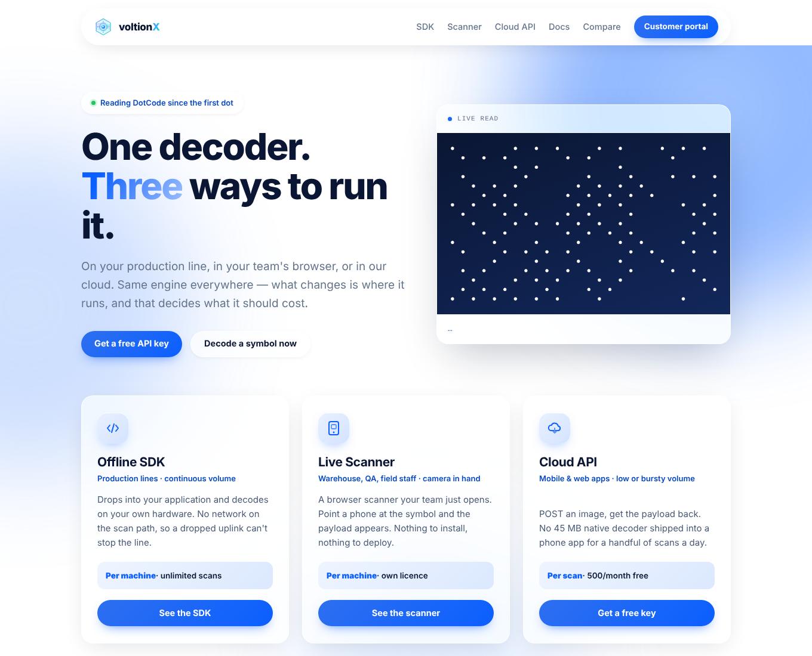
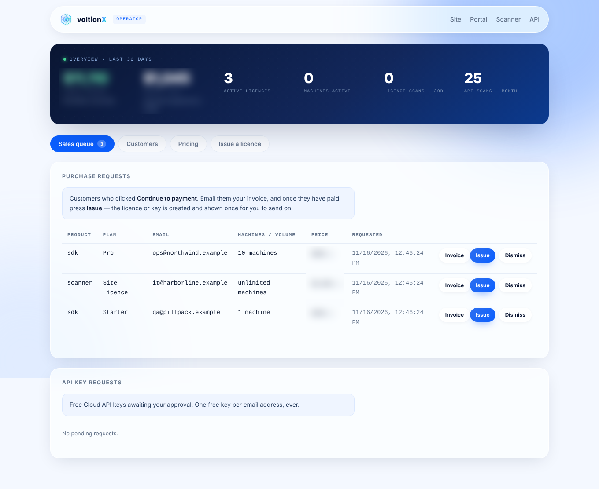
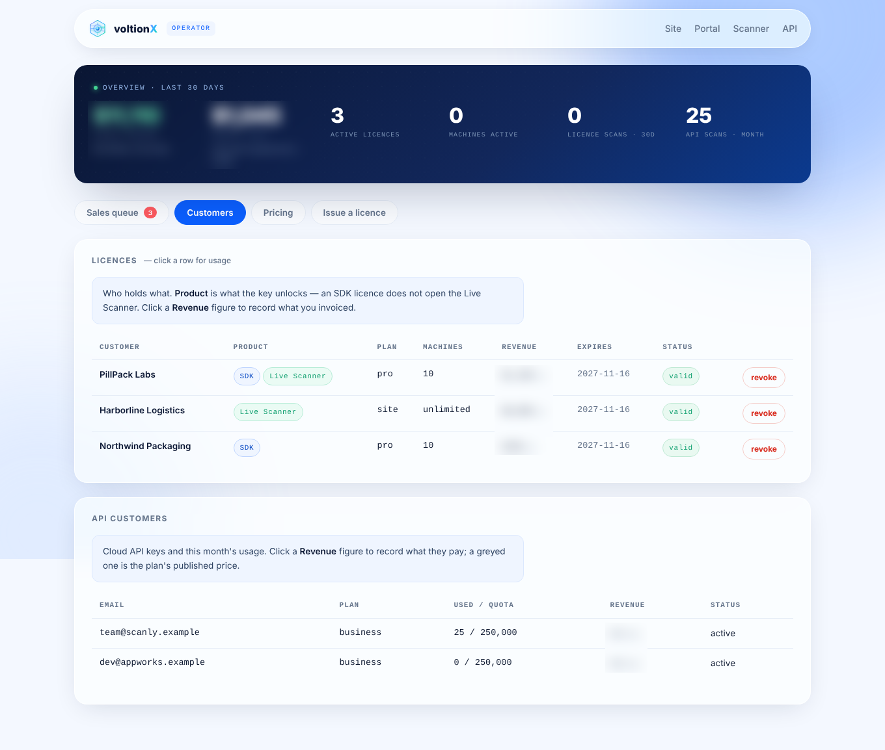
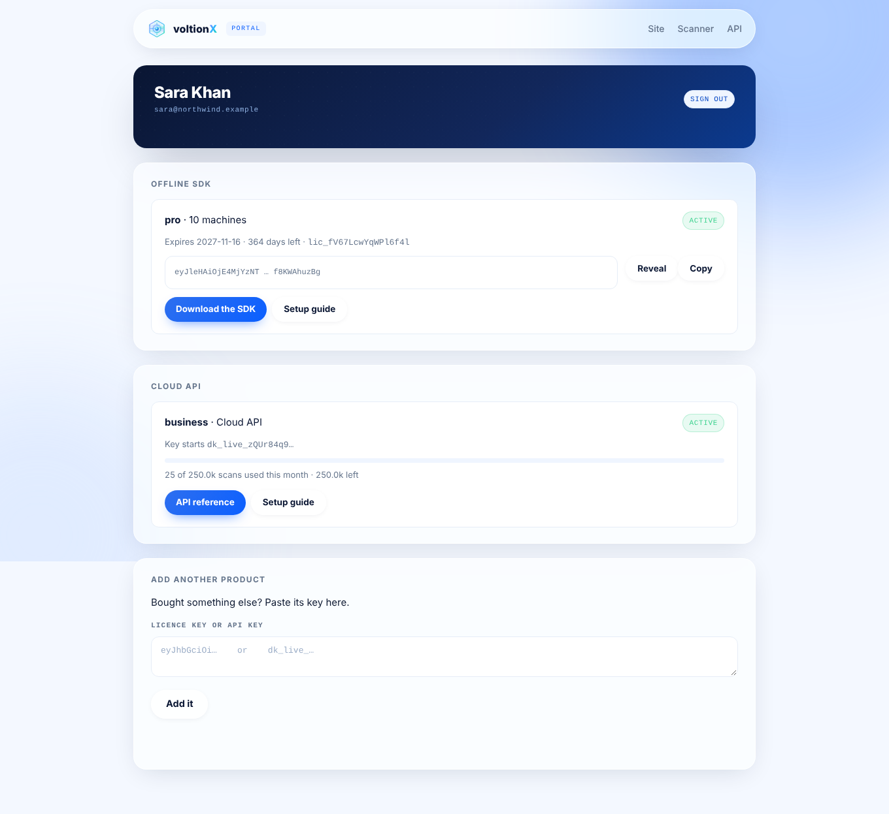

# voltionX DotCode Service

A complete, self-hosted platform for reading **DotCode** and **GS1 DotCode** barcodes, with licensing, billing and customer accounts built in.

> **The source code is not published in this repository.**
> This page describes what the project is. If you want it, contact me directly (details at the bottom).

---

## What it is

A ready-to-run service for businesses that need to decode DotCode barcodes, the dot-matrix codes printed on tobacco packs, pharmaceuticals and other high-speed production lines. It reads both plain-text and GS1-structured data (GTIN, batch, expiry, serial number and so on).

You can run it as your own product: issue licences, sell plans and manage customers from one place.

## Three products in one

| Product | What the customer gets | Where decoding happens |
|---|---|---|
| **Offline SDK** | A Python package and a licence key | On the customer's own machine |
| **Live Scanner** | A web page that scans using a phone or tablet camera | On the server |
| **Cloud API** | An API key and a monthly scan quota | On the server |

## Screenshots

*All screens below use demo data. The names, emails and keys are made up.*

### Public website

The landing page explains the three products and lets visitors try a decode without signing up.

### Admin dashboard

Your control room: the sales queue with one-click invoice emails, every customer and licence, and fully editable plans.

### Customer portal

Customers sign in once and see everything they own: SDK licence, Live Scanner access and Cloud API key, with usage and a download button.

---

## What is included

- **Decoder**: DotCode and GS1 DotCode, with GS1 field parsing
- **Python SDK**: built per customer, signed with your own key, works offline
- **Licensing**: signed licence keys, machine limits, expiry with grace period, revocation
- **Admin dashboard**: sales queue, customers, editable plans, licence issuing
- **Customer portal**: sign up and sign in, see every product you own in one place, download the SDK
- **Invoicing workflow**: manual sales flow with a ready-to-send invoice email
- **Revenue overview**: booked revenue and monthly rate
- **Documentation**: customer integration guide, API reference, deployment guide
- **Deployment**: Docker Compose setup with automatic HTTPS
- **Tests**: automated test suite and an end-to-end check of the whole product

## Who it is for

- Companies that want to offer DotCode reading as their own product
- Teams that need a self-hosted decoder with licensing already solved
- Developers who want a working base to build on instead of starting from zero

## Get the project

There is no online checkout. The project is sold only through direct contact: email or WhatsApp. To ask about it, contact me by either of these:

- **Email:** maaz.ak92@gmail.com
- **WhatsApp:** +923122720832

Please mention what you plan to use it for, and I will get back to you.

---

*All rights reserved. Nothing in this repository grants permission to use, copy or distribute the project's source code.*
